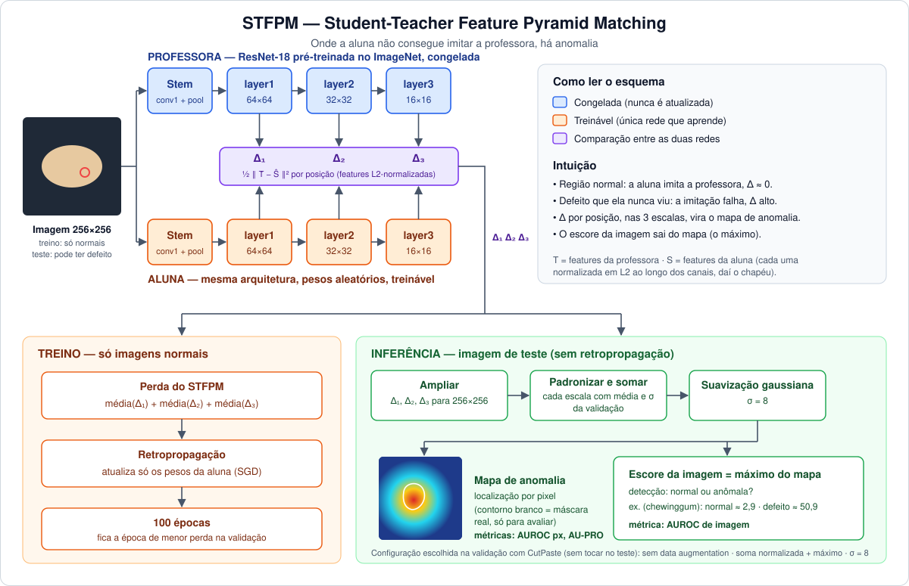

# Detecção de Anomalias Visuais — TP1 BCC406 (UFOP)

Detecção **one-class** de defeitos industriais no benchmark [VisA](https://github.com/amazon-science/spot-diff) (ECCV 2022): o modelo treina **só com imagens normais** e, no teste, atribui a cada imagem um **escore de anomalia** (detecção) e um **mapa por pixel** (localização).

| AUROC de imagem | AUROC de pixel | AU-PRO@30% | Baseline do kit |
|:---:|:---:|:---:|:---:|
| **93,96%** | **98,61%** | **91,34%** | 77,3% (AUROC de imagem) |

*Médias das 12 categorias do VisA.*

## Sumário

1. [O problema](#o-problema)
2. [Método: STFPM](#método-stfpm)
3. [Escolha de hiperparâmetros sem tocar no teste (CutPaste)](#escolha-de-hiperparâmetros-sem-tocar-no-teste-cutpaste)
4. [Resultados](#resultados)
5. [Estrutura do repositório](#estrutura-do-repositório)
6. [Como rodar](#como-rodar)
7. [Conformidade com as regras do TP](#conformidade-com-as-regras-do-tp)
8. [Referências](#referências)

---

## O problema

Defeitos industriais são raros, variados e imprevisíveis: não dá para coletar exemplos de todos. O que existe em abundância são fotos de produtos **normais**. A tarefa é aprender "o que é normal" e sinalizar desvios, **sem nunca ver um defeito real no treino** (protocolo one-class: o teste é usado uma única vez, só na avaliação final).

O VisA tem 12 categorias, de objetos simples (castiçais, macarrão, castanha) a placas eletrônicas (PCBs). O modelo vê apenas isto no treino:

<p align="center">
  
  <br><sub><b>Figura 1.</b> Uma imagem normal de treino por categoria.</sub>
</p>

E precisa reconhecer isto no teste. O contorno vermelho é a máscara real do defeito, usada **somente para avaliar**:

<p align="center">
  
  <br><sub><b>Figura 2.</b> Uma imagem anômala de teste por categoria. Os defeitos são pequenos e sutis (arranhões, lascas, falta de componente), o que torna o problema difícil.</sub>
</p>

---

## Método: STFPM

<p align="center">
  
  <br><sub><b>Esquema do método.</b> A professora (azul) e a aluna (laranja) processam a mesma imagem. A diferença entre suas features em 3 escalas (roxo) alimenta a perda no treino e, na inferência, vira o mapa de anomalia e o escore da imagem.</sub>
</p>

**STFPM** — *Student-Teacher Feature Pyramid Matching* (Wang et al., BMVC 2021), implementado do zero em PyTorch:

- **Professora**: ResNet-18 pré-treinada no ImageNet, congelada, truncada em `layer3`.
- **Aluna**: mesma arquitetura, pesos aleatórios, treinada por retropropagação **só com imagens normais** para imitar as features da professora em 3 escalas (64×64, 32×32, 16×16), com features L2-normalizadas.
- **Intuição**: nas regiões normais a aluna imita bem; num defeito que ela nunca viu, a imitação falha. Essa discrepância, por posição, é o **mapa de anomalia**; o escore da imagem deriva do mapa.
- **Por que não um autoencoder?** Autoencoders de pixels tendem a generalizar demais e reconstruir o próprio defeito; comparar features de uma rede pré-treinada é mais robusto a variações normais de textura e iluminação.

**Treino:** 100 épocas, SGD (lr 0,4, momentum 0,9, wd 1e-4), batch 32, imagens 256×256, precisão mista; época final = menor perda de validação. Um modelo por categoria (~2,8M parâmetros treináveis; ~2–4 min/categoria numa T4, 33 min no total; inferência ~10 ms/imagem).

---

## Escolha de hiperparâmetros sem tocar no teste (CutPaste)

### O dilema

O split de validação do VisA contém **só imagens normais**. Sem nenhum defeito, não há como medir se uma configuração detecta anomalias melhor que outra. Usar o teste para escolher seria trapacear: ele só pode ser aberto uma vez, na avaliação final.

### A solução: fabricar defeitos de validação

Usamos **CutPaste** (Li et al., CVPR 2021): recortamos um retângulo da própria imagem e colamos em outra posição. Isso cria um defeito artificial **sem precisar de nenhuma imagem anômala real**.

<p align="center">
  
  <br><sub><b>Figura 3.</b> Linha de cima: imagens normais de validação. Linha de baixo: as mesmas imagens com CutPaste. Repare no bloco deslocado no castiçal, na castanha, no fryum e no macarrão.</sub>
</p>

### O que está acontecendo na imagem

- O pedaço colado **vem da própria imagem**, então a cor e a textura são plausíveis. Mas ele aparece num lugar onde **não deveria estar**: a borda do objeto é cortada, a forma fica quebrada, uma parte do fundo some ou aparece onde não existia.
- Para o modelo, isso é parecido com um defeito real: uma **irregularidade local** num padrão que, no resto da imagem, é regular. É exatamente o tipo de desvio que a aluna, treinada só com normais, nunca viu e não consegue imitar.
- Essas imagens **nunca são usadas no treino**. Servem apenas para medir.

### Por que isso ajuda

Calculamos o **AUROC-proxy** {val normal × val danificada}. Como essas anomalias sintéticas são imperfeitas (nem toda categoria se comporta igual a um defeito real), tratamos o resultado como um **sinal para ranquear configurações**, não como a nota final. Ele escolhe, antes de qualquer contato com o teste:

- **data augmentation** on/off (flips aleatórios no treino — cada categoria tem duas alunas treinadas);
- **σ** da suavização gaussiana do mapa ∈ {2, 4, 8};
- **regra de pontuação** (produto das escalas + máximo / soma normalizada + máximo / produto + top-1%).

A configuração vencedora foi **sem data augmentation**, regra **soma normalizada + máximo** e **σ = 8** (AUROC-proxy médio de 93,64%).

### Fluxo completo

```
treinar (só normais)  →  escolher config. pelo AUROC-proxy (val + CutPaste)  →  avaliar no teste UMA vez
```

---

## Resultados

Avaliação oficial do kit, imagens 256×256.

### Visão geral por categoria

| Categoria | AUROC img (%) | AUROC px (%) | AU-PRO@30% (%) |
|---|---|---|---|
| candle | 90,99 | 98,90 | 95,23 |
| capsules | 83,78 | 98,55 | 87,54 |
| cashew | 96,00 | 98,27 | 92,70 |
| chewinggum | 99,06 | 98,47 | 82,92 |
| fryum | 95,92 | 95,51 | 84,25 |
| macaroni1 | 95,04 | 99,47 | 96,60 |
| macaroni2 | 87,44 | 99,16 | 94,74 |
| pcb1 | 94,17 | 99,72 | 96,12 |
| pcb2 | 94,15 | 98,64 | 90,57 |
| pcb3 | 92,90 | 98,93 | 90,37 |
| pcb4 | 99,01 | 98,67 | 91,30 |
| pipe_fryum | 99,06 | 99,06 | 93,67 |
| **MÉDIA** | **93,96** | **98,61** | **91,34** |

**Como ler as métricas**

- **AUROC de imagem**: a imagem inteira é normal ou anômala? 100% = todo defeito pontua acima de toda imagem normal.
- **AUROC de pixel**: cada pixel é defeito ou não? Valor alto indica que o mapa acende na região certa.
- **AU-PRO@30%**: sobreposição média por região de defeito, com até 30% de falsos positivos. Penaliza o modelo que só acerta defeitos grandes e ignora os pequenos.

A **localização é mais forte que a detecção** (98,6% contra 94,0%): quase sempre que o mapa acende, é no lugar certo. As falhas de detecção vêm de imagens normais com escore alto e de defeitos minúsculos.

### Curvas ROC

<p align="center">
  
  <br><sub><b>Figura 4.</b> À esquerda: ROC de imagem das 12 categorias (em destaque, a categoria mediana, macaroni1). À direita: na categoria mediana, STFPM (95,0%) contra o baseline do kit (75,1%).</sub>
</p>

- **Esquerda**: quanto mais a curva "cola" no canto superior esquerdo, melhor. Quase todas passam de 90% de detecção com poucos falsos alarmes. As curvas mais baixas (capsules, macaroni2) são as categorias difíceis.
- **Direita**: a curva vermelha fica acima da cinza em praticamente toda a faixa, ou seja, treinar a aluna rende ganho real sobre só comparar features da professora (baseline sem treino).

Baseline do kit (ResNet-18 congelada + distância à média por posição, sem treino): **77,3%** de AUROC de imagem médio.

### Mapas de anomalia × anomalias reais

<p align="center">
  
  <br><sub><b>Figura 5.</b> Para cada categoria: imagem de teste (linha 1), máscara real do defeito (linha 2) e mapa de anomalia do STFPM (linha 3).</sub>
</p>

Compare as duas últimas linhas: as regiões quentes (vermelho/amarelo) do mapa coincidem com as manchas brancas da máscara real na maioria das categorias (chewinggum, pcb3, pcb4, cashew, fryum). O mapa é suave e um pouco mais "gordo" que a máscara, efeito da suavização gaussiana e da resolução das features (64×64).

### Acertos e erros em detalhe (VP / VN / FP / FN)

Cada figura abaixo mostra, para uma categoria, 4 casos usando o **limiar escolhido na validação**:

| Sigla | Significa | Imagem |
|---|---|---|
| **VP** | verdadeiro positivo | anômala, escore acima do limiar (acertou) |
| **VN** | verdadeiro negativo | normal, escore abaixo do limiar (acertou) |
| **FP** | falso positivo | normal, escore acima do limiar (alarme falso) |
| **FN** | falso negativo | anômala, escore abaixo do limiar (defeito perdido) |

Linha de cima: imagem com a máscara real em verde. Linha de baixo: mapa de anomalia, com a máscara em branco.

#### chewinggum — caso fácil (AUROC 99,1%)

<p align="center">
  
</p>

O defeito grande é pego com folga (escore 50,9 contra ~2,9 de uma normal) e o mapa o cobre bem. O único FN são duas lascas minúsculas nas bordas, quase invisíveis.

#### pcb4 — placa eletrônica (AUROC 99,0%)

<p align="center">
  
</p>

O mapa localiza os defeitos no conector e no componente. O FP é uma placa normal com um ponto quente no canto; o FN é um defeito muito pequeno num componente.

#### capsules — caso difícil (AUROC 83,8%)

<p align="center">
  
</p>

A pior categoria. A cena tem dezenas de cápsulas em posições e orientações livres, então a variação **normal** já é grande. O FP mostra isso: uma imagem normal com arranjo incomum acende quase inteira. Já os defeitos muitas vezes são minúsculos (o FN é um ponto de poucos pixels).

---

O notebook também traz a ablação (aluna sem treino), a comparação de regras de pontuação, as curvas de perda, o custo computacional e mais análises qualitativas.

---

## Estrutura do repositório

```
onechance.ipynb   # todo o trabalho: código + relatório + saídas
onechance.csv     # resultados oficiais por categoria (gerado pelo notebook)
docs/stfpm.svg    # esquema da arquitetura (usado no README)
README.md
LICENSE
```

Não versionados (ver `.gitignore`):

- `content/` — dataset VisA e material da disciplina (`tp1_utils.py`, enunciado, baseline de exemplo).
- `cache/`, `modelos_stfpm/`, `*.pt` — caches e checkpoints de treino.

## Como rodar

### Google Colab (recomendado)

1. No Drive, crie `MyDrive/TP1_BCC406/` com `datasets/visa.zip` (dataset da disciplina) e `kit/tp1_utils.py`.
2. Abra `onechance.ipynb` no Colab e ative a GPU (T4).
3. Rode tudo. A primeira célula copia e descompacta o zip no disco local; checkpoints, figuras e CSV são salvos no Drive (`RETREINAR = False` reaproveita checkpoints entre sessões).

Rodada completa: ~70–80 min na T4 (2 variantes × 12 categorias). Para testar rápido, defina na célula de configuração `CATS_RODAR = ["pcb1"]` (treina/avalia só essas categorias; o CSV oficial só sai com as 12).

### Local

```bash
pip install torch torchvision numpy pandas matplotlib scikit-learn scipy pillow jupyter
export TP1_RAIZ=content          # pasta que contém visa/split.csv
jupyter notebook onechance.ipynb
```

O dataset VisA (~2 GB) não está no repositório: baixe pela disciplina ou pelo [repositório oficial](https://github.com/amazon-science/spot-diff) e coloque em `content/visa/`.

## Conformidade com as regras do TP

Só CNNs (ResNet-18); pesos pré-treinados só do ImageNet; aluna treinada do zero com retropropagação; treino e **toda** escolha de hiperparâmetros usando apenas imagens normais de `train`/`val` (+ danos sintéticos, permitidos pela regra R3); teste usado uma única vez; métricas pelo `tp1_utils.py` sem modificação; nenhuma biblioteca de detecção pronta.

## Referências

- Wang et al., *Student-Teacher Feature Pyramid Matching for Anomaly Detection*, BMVC 2021 — método.
- Zou et al., *SPot-the-Difference*, ECCV 2022 — dataset VisA.
- Li et al., *CutPaste*, CVPR 2021 — anomalias sintéticas de validação.
- Bergmann et al., *Uninformed Students*, CVPR 2020 — métrica PRO.

---
*Trabalho da disciplina BCC406 — Redes Neurais e Aprendizagem em Profundidade (DECOM/UFOP, Prof. Eduardo Luz).*
